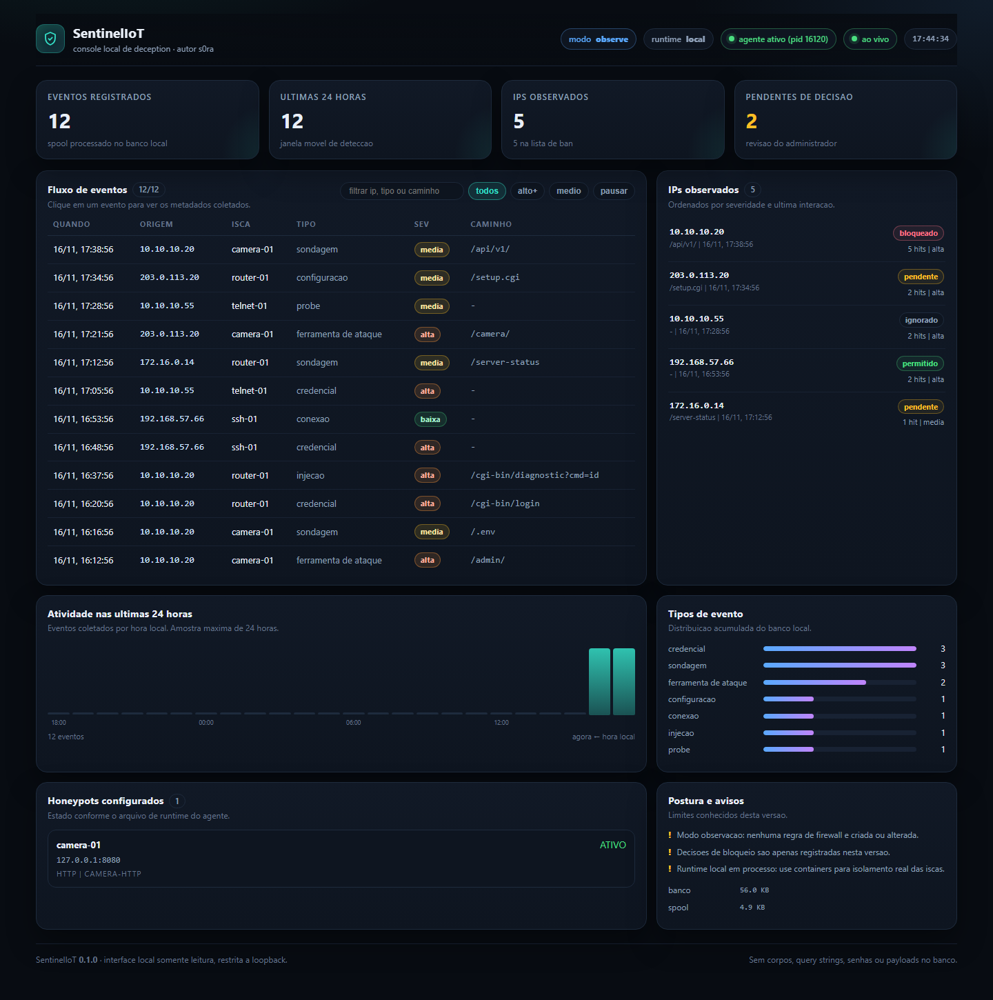
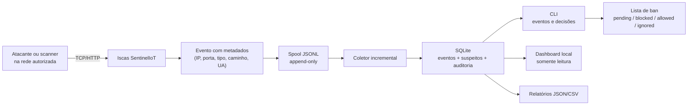

# SentinelIoT

## Defesa proativa para redes IoT baseada em *Deception Technology*

<p align="center">
  
</p>

<p align="center"><em>Dashboard local somente leitura do MVP, restrito a loopback.</em></p>

---

| | |
|---|---|
| **Autor** | s0ra |
| **Instituição** | _[preencher: instituição de ensino]_ |
| **Curso** | _[preencher: curso / programa]_ |
| **Orientador(a)** | _[preencher: nome]_ |
| **Coorientador(a)** | _[opcional]_ |
| **Tipo de trabalho** | _[preencher: TCC, projeto integrador, iniciação científica ou similar]_ |
| **Versão do produto** | 0.1.0 (MVP) |
| **Data** | Novembro de 2026 |
| **Repositório** | `SentinelIoT` |
| **Licença** | Ainda não definida |

---

## Resumo

O crescimento de dispositivos IoT em redes domésticas e de pequenas empresas
ampliou a superfície de ataque sem que a maioria dos administradores disponha de
monitoramento contínuo. Este trabalho apresenta o **SentinelIoT**, um agente
defensivo local que utiliza *deception technology* para observar interações
suspeitas: serviços-isca (honeypots) simulam uma câmera IP, um painel de
roteador, um servidor SSH e um dispositivo Telnet. Qualquer conexão recebida é
registrada como metadado, classificada por tipo e severidade e convertida em
uma lista de IPs suspeitos para decisão do administrador.

O MVP foi implementado em Python, com spool JSONL *append-only*, banco SQLite,
CLI local, runtime em processo ou em container Docker isolado e dashboard HTTP
somente leitura. A proposta não substitui firewall, segmentação ou EDR: ela
funciona como uma camada de **detecção passiva e baixa interferência**, cujo
valor está em observar o que chega às iscas, explicar o motivo da classificação
e apoiar a decisão humana. O projeto é voltado a laboratório próprio e redes com
autorização expressa; nenhum bloqueio real de firewall é aplicado na versão
atual.

**Palavras-chave:** segurança de redes; Internet das Coisas; *deception
technology*; honeypots; detecção de intrusão; privacidade.

---

## 1. Contexto e problema

Câmeras IP, roteadores e dispositivos Telnet frequentemente são instalados com
credenciais padrão, firmware desatualizado e serviços expostos sem
monitoramento. Em redes domésticas e de pequenas empresas, não é comum existir
um SIEM, um IDS dedicado ou uma equipe de segurança em tempo integral. O
resultado é uma assimetria: o atacante pode testar várias abordagens, enquanto o
administrador raramente sabe que houve tentativa.

O problema central deste trabalho é:

> Como detectar atividade suspeita direcionada a dispositivos IoT em uma rede
> pequena, com baixo custo de operação e sem depender de agentes instalados em
> cada dispositivo?

A hipótese adotada é a de que serviços-isca convincentes, posicionados como
alvos fáceis, podem atrair e revelar comportamento malicioso antes que um ativo
real seja comprometido.

## 2. Objetivos

### 2.1 Objetivo geral

Desenvolver um MVP de agente defensivo local capaz de simular dispositivos IoT,
registrar interações suspeitas, classificar eventos de forma explicável e
apresentar uma fila de decisão ao administrador.

### 2.2 Objetivos específicos

1. Implementar perfis de honeypot para HTTP (câmera e roteador), SSH e Telnet.
2. Registrar apenas metadados de conexão, sem armazenar corpos, senhas,
   *query strings* ou *payloads*.
3. Classificar interações em tipos e severidades auditáveis.
4. Persistir eventos em spool JSONL e SQLite com coleta incremental.
5. Manter uma lista de IPs suspeitos com estados de decisão.
6. Oferecer runtime local e runtime em container isolado.
7. Disponibilizar um dashboard local somente leitura para demonstração.
8. Validar o fluxo em laboratório isolado, com autorização documentada.

## 3. Justificativa

A abordagem de *deception* tem três vantagens para o contexto acadêmico e para
redes de pequeno porte:

- **Sinal de alta intenção:** uma isca não deveria receber tráfego legítimo com
  frequência; acessos incomuns merecem atenção.
- **Baixo risco de produção:** as iscas não executam o conteúdo recebido e não
  armazenam credenciais; o risco ao ambiente é menor do que o de expor o ativo
  real.
- **Explicabilidade:** o evento carrega o motivo da classificação (por exemplo,
  *User-Agent* de ferramenta automatizada ou caminho sensível), o que permite ao
  administrador entender por que o IP foi sinalizado.

O projeto também tem valor didático: exercita arquitetura de software, redes,
containerização, persistência, testes automatizados, análise de risco,
privacidade e resposta a incidentes em um laboratório controlado.

## 4. Fundamentação e trabalhos relacionados

Honeypots clássicos variam de baixa a alta interação. Este MVP adota
**baixa interação**: os serviços não oferecem um sistema real, apenas respostas
verossímeis para coletar metadados. A literatura de honeypots (Spitzner, 2003;
Provos, 2004) destaca a redução de falso negativo para tráfego direcionado, ao
custo de visibilidade limitada: a isca só vê o que chega até ela.

O trabalho dialoga com recomendações de detecção e resposta (NIST SP 800-94),
com a necessidade de inventário e gestão de dispositivos IoT (NISTIR 8228) e com
os riscos recorrentes do OWASP IoT Top 10, como credenciais fracas, serviços
expostos e falta de atualização. A contribuição aqui não é um novo algoritmo de
detecção, mas a integração reproduzível de iscas, classificação explicável,
persistência local e visualização para um cenário acadêmico de pequeno porte.

## 5. Arquitetura



### 5.1 Componentes

| Camada | Responsabilidade |
|---|---|
| Iscas | Simulam câmera IP, roteador, banner SSH e prompt Telnet. |
| Spool | Arquivo JSONL *append-only* com um evento por linha. |
| Coletor | Lê apenas eventos novos, valida e grava no SQLite. |
| Banco | Eventos, suspeitos, decisões e trilha de auditoria. |
| CLI | Operação, consulta, exportação e decisão do administrador. |
| Dashboard | Visualização local somente leitura, sem endpoints de escrita. |
| Runtime | `local` (em processo) ou `docker` (uma isca por container). |

### 5.2 Fluxo de um evento

1. O atacante alcança uma porta publicada por uma isca.
2. O servidor-isca responde de forma verossímil e coleta metadados.
3. A classificação gera um ou mais sinais explicáveis.
4. O evento é gravado no spool JSONL.
5. O coletor incremental leva o evento ao SQLite e atualiza o IP suspeito.
6. A CLI e o dashboard exibem o evento; o administrador decide o destino do IP.

## 6. Como o produto funciona

### 6.1 Iscas

- `camera-http`: página de câmera IP, painel administrativo e respostas HTTP.
- `router-admin`: interface de roteador com caminhos típicos de administração.
- `ssh-banner`: banner SSH e leitura de um primeiro *payload*.
- `telnet-iot`: prompt Telnet com tentativa de login.

As iscas escutam em `127.0.0.1` por padrão. No laboratório, podem ser publicadas
em uma interface host-only ou em uma rede interna isolada. O runtime Docker
reforça o isolamento com usuário não-root, remoção de *capabilities*,
`no-new-privileges`, filesystem somente leitura, limites de CPU/RAM/PIDs, rede
interna sem egress e ausência de `docker.sock`.

### 6.2 Classificação explicável

Cada interação HTTP pode gerar mais de um sinal. Os principais são:

| Sinal | Severidade | Critério resumido |
|---|---|---|
| `attack_tool` | alta | *User-Agent* de ferramenta automatizada (`sqlmap`, `nikto`, `nmap`, `hydra`, `curl`, etc.). |
| `injection_attempt` | alta | Padrão de injeção na URL (`union select`, `or 1=1`, `../`, `<script`, etc.). |
| `credential_attempt` | alta | `POST` para caminho de login, autenticação ou `cgi-bin`. |
| `honeypot_probe` | média | Acesso a caminho sensível (`/admin`, `/.env`, `/.git`, `/cgi-bin`, `/server-status`, etc.). |
| `auth_failure` | média | Resposta HTTP 401 ou 403 na isca. |
| `probe` | média | *Payload* inesperado após o banner SSH. |
| `connection` | baixa | Conexão TCP ou handshake básico. |
| `request` | baixa | Requisição HTTP sem outro sinal. |

A classificação é **determinística e auditável**: não há modelo de machine
learning no MVP. Isso reduz custo, facilita testes e permite explicar cada
decisão. A contrapartida é maior dependência de regras e da calibração do
ambiente.

### 6.3 Lista de ban e decisão humana

Cada IP que interage com uma isca aparece uma única vez na lista de suspeitos,
com primeira e última interação, contagem de eventos, severidade máxima e último
caminho observado. O administrador pode registrar:

- `pending`: aguardando análise;
- `blocked`: decisão de bloquear;
- `allowed`: decisão de permitir;
- `ignored`: IP ignorado;
- `allowlisted`: IP pertencente à allowlist.

No MVP, `blocked` **não cria regra de firewall**. A decisão é registrada e
auditada; a aplicação real de bloqueio permanece fora do escopo desta versão.

### 6.4 Dashboard local

O comando `serve` sobe uma interface HTTP somente leitura em
`http://127.0.0.1:8787/`, com indicadores, fluxo de eventos, filtros, detalhe de
metadados, IPs observados, atividade por hora, tipos de evento, estado das iscas
e avisos de postura. Métodos de escrita retornam `405`; a interface não permite
decidir, editar ou excluir. O servidor recusa host fora do loopback sem a opção
explícita `--allow-remote`.

## 7. O que o atacante precisa fazer para o Sentinel responder

**Requisito mínimo:** conseguir alcançar uma porta de uma isca. Não é necessário
explorar vulnerabilidade, autenticar, enviar credenciais válidas ou conhecer o
produto. Qualquer conexão ou requisição aceita pela isca gera pelo menos um
evento.

| Ação do atacante | Evento provável | Severidade |
|---|---|---|
| Conectar TCP à porta SSH ou Telnet e desconectar | `connection` | baixa |
| Enviar handshake SSH (`SSH-...`) | `connection` | baixa |
| Enviar *payload* inesperado após o banner SSH | `probe` | média |
| Enviar usuário e senha no prompt Telnet | `credential_attempt` | alta |
| `GET /` na isca HTTP | `request` | baixa |
| `GET /admin`, `/.env`, `/.git`, `/cgi-bin`, `/server-status` | `honeypot_probe` | média |
| Requisição com *User-Agent* `sqlmap`, `nikto`, `nmap`, `hydra` etc. | `attack_tool` | alta |
| URL com `union select`, `or 1=1`, `../` ou `<script>` | `injection_attempt` | alta |
| `POST` para `/login`, `/auth`, `/session` ou `/cgi-bin/...` | `credential_attempt` | alta |
| Requisição que recebe 401/403 | `auth_failure` | média |

Observações importantes:

- **Uma única requisição pode gerar vários eventos.** Por exemplo, `sqlmap`
  acessando `/admin/?id=1 union select ...` pode produzir `attack_tool`,
  `injection_attempt` e `honeypot_probe` de uma só vez.
- **Não é necessário um ataque sofisticado.** Um scanner de portas, um
  `curl` automatizado, um *crawler* ou até um teste manual do administrador
  geram eventos.
- **A isca é passiva.** Se o atacante não tocar em nenhuma isca, o Sentinel não
  registra nada. A ausência de eventos não prova ausência de ataque.
- **Falsos positivos existem.** Ferramentas de inventário, monitores e testes
  legítimos podem ser classificados como suspeitos; por isso a decisão final é
  humana e a allowlist é configurável.
- **O IP registrado é o da conexão.** Em laboratório, é o endereço da VM
  atacante; em rede com NAT ou proxy, pode ser o endereço do gateway.

### 7.1 Exemplo mínimo reproduzível

Com o agente e uma isca HTTP em `127.0.0.1:8080`:

```powershell
Invoke-WebRequest http://127.0.0.1:8080/admin/ -Headers @{ "User-Agent" = "sqlmap/1.8" }
.\sentineliot.cmd scan
.\sentineliot.cmd events list
.\sentineliot.cmd bans list
```

Esse único pedido tende a gerar `attack_tool` e `honeypot_probe`, com o IP de
origem `127.0.0.1` e severidade máxima alta.

## 8. Demonstração

### 8.1 Sem infraestrutura adicional

```powershell
uv sync
.\sentineliot.cmd serve --demo --open
```

O comando popula um cenário de demonstração **apenas quando o banco está vazio**
e abre o dashboard em `http://127.0.0.1:8787/`. O cenário contém 12 interações,
5 IPs, iscas HTTP/SSH/Telnet e decisões de exemplo.

### 8.2 Com tráfego real de laboratório

```powershell
.\sentineliot.cmd start
.\sentineliot.cmd honeypots add camera-http --port 8080 --id camera-demo
Invoke-WebRequest http://127.0.0.1:8080/admin/ -Headers @{ "User-Agent" = "sqlmap/1.8" }
.\sentineliot.cmd scan
.\sentineliot.cmd serve --open
```

### 8.3 Com iscas em container

```powershell
docker build -f deploy/honeypot/Dockerfile -t sentineliot-honeypot:0.1.0 .
# config/config.yaml: honeypot.runtime: docker
.\sentineliot.cmd diagnostics
.\sentineliot.cmd start
```

## 9. Resultados e evidências

Ambiente de desenvolvimento: Windows 11, Python 3.11.16, `uv`, SQLite e Chrome
headless para validação visual.

| Verificação | Resultado |
|---|---|
| Testes automatizados | 80 passaram |
| Lint | `ruff`: sem ocorrências |
| Tipagem | `mypy`: sem erros em 42 arquivos |
| Cenário de demonstração | 12 eventos, 5 IPs, 2 pendentes, 24 buckets horários |
| Dashboard | `GET /` 200; `GET /healthz` 200; `POST` 405 |
| Fluxo ponta a ponta | requisição com *User-Agent* `sqlmap/1.8` gerou 2 eventos, 1 `attack_tool` de severidade alta |
| Isolamento Docker | implementado e testado por testes unitários; homologação na VM Linux pendente |

Esses resultados demonstram a viabilidade do fluxo de ponta a ponta, não a
eficácia em produção. A validação com tráfego de atacante real, em rede isolada
e autorizada, está documentada em [docs/lab-pentest.md](docs/lab-pentest.md) e
[docs/lab-authorization.md](docs/lab-authorization.md).

## 10. Segurança, ética e privacidade

- Uso restrito a laboratório próprio ou rede com autorização expressa.
- Nenhuma varredura na Internet, em câmeras reais ou em redes de terceiros.
- O modo padrão é `observe`; o bloqueio automático está desabilitado.
- `bans block` apenas registra uma decisão; não altera firewall.
- O banco não armazena corpo de requisição, *query string*, senha ou *payload*.
  Apenas metadados mínimos são persistidos.
- O dashboard é local, sem autenticação e restrito a loopback por padrão.
- IPs e metadados podem ser dados pessoais; recomenda-se retenção limitada,
  acesso restrito e avaliação jurídica antes de uso fora do laboratório.
- O container reduz risco, mas não é uma fronteira absoluta: Docker compartilha
  o kernel do host.

## 11. Limitações

- A isca só detecta o tráfego que chega até ela; não há visibilidade de toda a
  rede.
- A classificação é baseada em regras e pode gerar falsos positivos e falsos
  negativos.
- Não há machine learning, correlação avançada, resposta automática ou MFA.
- O bloqueio de firewall não é aplicado nesta versão.
- A homologação do runtime Docker na VM Linux ainda precisa de evidências
  registradas.
- O dashboard não é um portal administrativo e deve ser encerrado após a
  demonstração.
- A licença do projeto ainda não foi definida.

## 12. Trabalhos futuros

1. Homologar o runtime Docker em VM Linux com evidências de isolamento e rede.
2. Integrar bloqueio real por nftables em tabela própria, com TTL, allowlist,
   limites e trilha de auditoria.
3. Ampliar perfis de isca e calibrar regras com tráfego de laboratório.
4. Adicionar correlação temporal e detecção de rajadas por origem.
5. Melhorar notificações e relatórios exportáveis.
6. Avaliar o impacto de privacidade e a conformidade com a LGPD.
7. Definir licença e política de contribuição antes de distribuição.

## 13. Referências

- SPITZNER, Lance. *Honeypots: Tracking Hackers*. Addison-Wesley, 2003.
- PROVOS, Niels; HOLZ, Thorsten. *Virtual Honeypots: From Botnet Tracking to
  Intrusion Detection*. Addison-Wesley, 2008.
- NIST. *SP 800-94: Guide to Intrusion Detection and Prevention Systems
  (IDPS)*. 2007.
- NIST. *NISTIR 8228: Considerations for Managing Internet of Things (IoT)
  Cybersecurity and Privacy Risks*. 2019.
- OWASP. *OWASP IoT Top 10*. 2018.
- MITRE. *ATT&CK Framework*. Disponível em: <https://attack.mitre.org/>.
- BRASIL. *Lei nº 13.709/2018 — Lei Geral de Proteção de Dados Pessoais
  (LGPD)*. 2018.

## Apêndice A — Documentação do repositório

- [README do projeto](README.md)
- [Arquitetura](docs/architecture.md)
- [Modelo de ameaças](docs/threat-model.md)
- [Configuração](docs/configuration.md)
- [Operação](docs/operations.md)
- [Privacidade](docs/privacy.md)
- [Plano de testes](docs/test-plan.md)
- [Progresso](docs/progress.md)
- [Laboratório](docs/lab.md)
- [Decisões arquiteturais](docs/decisions/)

---

<p align="center"><em>Documento de apresentação acadêmica do MVP SentinelIoT.</em></p>
