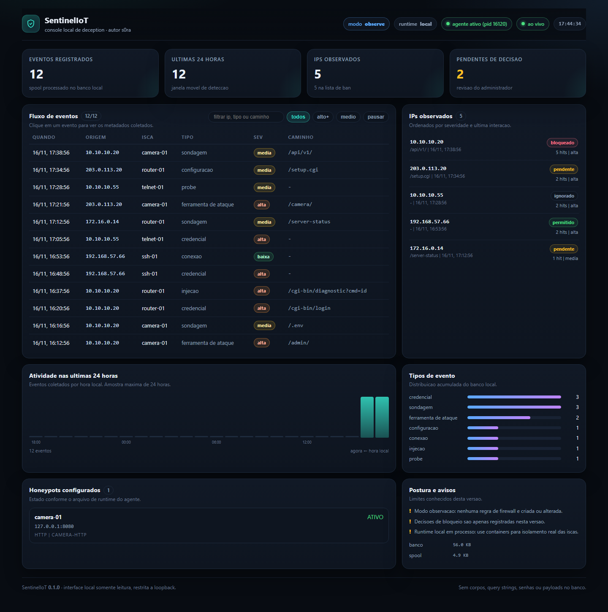

# SentinelIoT

Agente defensivo local para redes domésticas e pequenas empresas. O produto
executa serviços-isca (honeypots) que simulam uma câmera IP, um roteador, um SSH
corporativo e um dispositivo Telnet, registra interações suspeitas e monta uma
lista de IPs para decisão do administrador.

> **Status atual:** runtimes `local` (em processo, padrão no Windows) e `docker`
> (iscas isoladas em container) implementados, com o mesmo spool JSONL, SQLite e
> lista de ban. O dashboard local somente leitura (`serve`) está disponível para
> demonstração e operação assistida. Veja [ADR-0014](docs/decisions/ADR-0014.md),
> [ADR-0015](docs/decisions/ADR-0015.md) e [ADR-0016](docs/decisions/ADR-0016.md).
> A homologação na VM Linux ainda precisa de evidências.



*Dashboard local somente leitura, restrito a loopback: `sentineliot serve --demo --open`.*

## Aviso de segurança

- Use somente em laboratório próprio ou rede com autorização expressa.
- Não execute varreduras na Internet, não acesse câmeras reais e não teste em
  redes de terceiros.
- O modo padrão é `observe`. O bloqueio automático é desabilitado.
- `bans block <ip>` **apenas registra a decisão**. Nenhuma regra de firewall é
  criada, alterada ou aplicada nesta versão.
- `scan` é uma varredura passiva do spool local; não é um scanner de rede.
- A isca só detecta o tráfego que chega até ela. Ausência de alertas não prova
  que a rede está livre de comprometimento.
- As iscas escutam em `127.0.0.1` por padrão. Não publique em `0.0.0.0` sem uma
  rede de laboratório isolada e autorização.

## O que já funciona

- Shell interativo com banner ASCII, nome do projeto e autor `s0ra`.
- Perfis de honeypot: `camera-http`, `router-admin`, `ssh-banner` e
  `telnet-iot`.
- Inclusão, remoção e listagem de iscas em tempo de execução.
- Agente em segundo plano que sobe e desce iscas conforme o estado persistido.
- Detecção de interações HTTP, SSH e Telnet, com classificação explicável.
- Spool JSONL append-only e coleta incremental para SQLite.
- Lista de ban com IPs observados e decisões `pending`, `blocked`, `allowed`,
  `ignored` e `allowlisted`.
- Exportação da lista em JSON e CSV.
- Comando `simulate` para demonstrar o fluxo sem uma segunda máquina.
- Runtime `docker` opcional: uma isca por container, sem root, com capabilities
  removidas, filesystem somente leitura, limites de CPU/RAM/PIDs, rede interna
  sem egress e sem `docker.sock`.
- Dashboard local somente leitura (`serve`): eventos, IPs observados, atividade
  por hora, tipos de evento, iscas e avisos de postura, com atualização
  automática. Escuta apenas em loopback por padrão.

## O que o projeto não é

- Um substituto de firewall, EDR, segmentação, atualização de firmware ou SOC.
- Um scanner de vulnerabilidades ou uma ferramenta de intrusão.
- Um produto com suporte universal a roteadores.
- Uma solução com IA/ML no MVP.
- Uma promessa de prevenção de todos os ataques IoT.
- Um honeypot pronto para exposição direta na Internet.

## Início rápido (Windows)

Pré-requisitos: Windows 11, Python 3.11 e [uv](https://docs.astral.sh/uv/).

```powershell
uv sync
.\sentineliot.cmd
```

O comando acima abre o shell interativo e mostra o banner. Se o caminho do
projeto tiver caracteres especiais, o launcher usa `PYTHONPATH` para contornar
uma limitação do Python 3.11 ao ler arquivos `.pth` no Windows.

Também é possível executar comandos diretos:

```powershell
.\sentineliot.cmd version
.\sentineliot.cmd --data-dir data/dev status
```

Em Linux/macOS com caminho ASCII, `uv run sentineliot` funciona diretamente.
Em qualquer plataforma, o equivalente explícito é:

```bash
PYTHONPATH=src uv run python -m sentineliot
```

## Demonstração rápida (dashboard)

Para mostrar o produto sem uma segunda máquina nem tráfego de rede:

```powershell
.\sentineliot.cmd serve --demo --open
```

O comando cria um cenário de demonstração **somente quando o banco está vazio**
(12 interações, 5 IPs, iscas HTTP/SSH/Telnet e decisões de exemplo), sobe o
dashboard em `http://127.0.0.1:8787/` e abre o navegador. Clique em um evento
para ver os metadados coletados; a interface não tem botões de escrita.

Para usar somente os dados reais já coletados:

```powershell
.\sentineliot.cmd start
.\sentineliot.cmd serve --port 8787
```

Opções: `--port`, `--host`, `--refresh` (1 a 60 s), `--open`, `--demo` e
`--allow-remote`. A última é recusada por padrão: a interface é local, sem
autenticação, e não deve ser publicada na rede. Use `Ctrl+C` para encerrar.

## Fluxo de uso

### 1. Conhecer e configurar as iscas

Dentro do shell:

```text
sentineliot> honeypots available
sentineliot> honeypots list
sentineliot> honeypots add telnet-iot --port 2323 --id telnet-01
```

Sem o shell:

```powershell
.\sentineliot.cmd honeypots available
.\sentineliot.cmd honeypots add router-admin --port 8081 --id router-01
```

### 2. Iniciar o agente

```powershell
.\sentineliot.cmd start
```

O agente roda em segundo plano, escreve o log e mantém as iscas ativas. Use
`start --foreground` para acompanhar no terminal atual e `stop` para encerrar.

### 3. Interagir com uma isca

Em outro terminal, aponte uma ferramenta de teste **do seu laboratório** para a
porta da isca. Exemplo com uma requisição HTTP local:

```powershell
Invoke-WebRequest http://127.0.0.1:8080/admin/ -Headers @{ "User-Agent" = "sqlmap/1.8" }
```

### 4. Coletar, revisar e decidir

```powershell
.\sentineliot.cmd scan
.\sentineliot.cmd events list
.\sentineliot.cmd bans list
.\sentineliot.cmd bans show 192.168.57.66
.\sentineliot.cmd bans block 192.168.57.66 --note "tentativa de login"
```

`start` já coleta eventos periodicamente; `scan` força uma coleta imediata. A
lista de ban é a fila de decisão do administrador.

### 5. Demonstrar sem uma segunda máquina

```powershell
.\sentineliot.cmd simulate
.\sentineliot.cmd bans list
```

`simulate` grava interações de exemplo no spool e as coleta imediatamente. Ela
não sonda a rede e não simula tráfego real.

## Comandos principais

| Comando | Função |
|---|---|
| `start [--foreground]` | inicia o agente e as iscas |
| `stop` | para o agente e as iscas |
| `status` | mostra agente, iscas, eventos e lista de ban |
| `scan` | coleta interações novas do spool (passivo) |
| `honeypots available` | lista os perfis disponíveis |
| `honeypots list` | lista as iscas configuradas |
| `honeypots add <perfil>` | adiciona uma isca (`--port`, `--host`, `--id`) |
| `honeypots remove <id>` | remove uma isca |
| `events [list]` | lista interações (`--limit`, `--ip`, `--type`) |
| `events show <id>` | detalha uma interação |
| `bans [list]` | lista IPs observados (`--status`) |
| `bans show <ip>` | detalha um IP e seus eventos |
| `bans block/allow/ignore/reset <ip>` | registra uma decisão (`--note`) |
| `bans export --format json\|csv` | exporta a lista de ban |
| `simulate [--ip <ip>]` | gera interações de demonstração |
| `serve [--demo] [--open]` | abre o dashboard local somente leitura |
| `diagnostics` | verifica ambiente, banco, spool e agente |
| `version` | mostra versão e autor |

## Lista de ban e privacidade

Cada IP de origem que interage com uma isca aparece uma única vez na tabela
`suspects`, com data da primeira e da última interação, contagem de eventos,
severidade máxima e último caminho observado.

As decisões são registradas e auditadas:

- `pending`: aguardando decisão do administrador;
- `blocked`: o administrador decidiu bloquear (sem efeito de rede nesta fase);
- `allowed`: o administrador decidiu permitir;
- `ignored`: IP marcado como ignorado;
- `allowlisted`: IP pertence à allowlist da configuração.

O banco não armazena corpo de requisição, query string, senha ou payload. Os
eventos guardam apenas metadados mínimos: horário, IP/porta de origem, isca,
tipo, severidade, método, caminho, status HTTP e user-agent. O dashboard lê os
mesmos campos e não oferece edição, exclusão ou decisão.

## Configuração

O runtime procura `config/config.yaml` e, se não existir, usa
`config/config.example.yaml`. O modo seguro padrão é `observe`, com firewall
`dry_run` e `enforce_enabled: false`.

```powershell
.\sentineliot.cmd --config config/config.yaml --data-dir data status
```

Principais campos: `agent.mode`, `agent.poll_interval_seconds`,
`agent.data_dir`, `honeypot.publish_host`, `honeypot.listen_port`,
`honeypot.runtime` (`local` ou `docker`) e `allowlist`. Veja
[docs/configuration.md](docs/configuration.md).

Para rodar as iscas em container:

```powershell
docker build -f deploy/honeypot/Dockerfile -t sentineliot-honeypot:0.1.0 .
# em config/config.yaml: honeypot.runtime: docker
.\sentineliot.cmd diagnostics
.\sentineliot.cmd start
```

O isolamento (non-root, `cap_drop ALL`, read-only, limites, rede interna sem
egress e sem `docker.sock`) e o teste de verificação estão em
[deploy/honeypot/README.md](deploy/honeypot/README.md).

## Desenvolvimento

```powershell
uv sync
uv run pytest
uv run ruff check src tests
uv run mypy src
```

O venv do Windows serve para desenvolvimento e testes. O runtime oficial será
provisionado na VM Linux conforme [docs/lab.md](docs/lab.md) e
[docs/installation.md](docs/installation.md).

## Estrutura do repositório

```text
config/            configuração de exemplo
deploy/honeypot/   Dockerfile, Compose e teste de isolamento da isca
docs/              arquitetura, ameaças, operação, privacidade e ADRs
scripts/           verificações e utilitários de laboratório
src/sentineliot/   CLI, agentes, iscas, coleta e persistência
tests/             testes unitários e de integração
```

## Documentação

- [Arquitetura](docs/architecture.md)
- [Modelo de ameaças](docs/threat-model.md)
- [Instalação](docs/installation.md)
- [Configuração](docs/configuration.md)
- [Operação](docs/operations.md)
- [Privacidade](docs/privacy.md)
- [Plano de testes](docs/test-plan.md)
- [Progresso](docs/progress.md)
- [Laboratório](docs/lab.md)
- [Decisões arquiteturais](docs/decisions/)

## Licença

A licença ainda não foi definida. O arquivo `LICENSE` será adicionado quando a
decisão for tomada. Até lá, não presuma permissão de uso, cópia ou distribuição.
